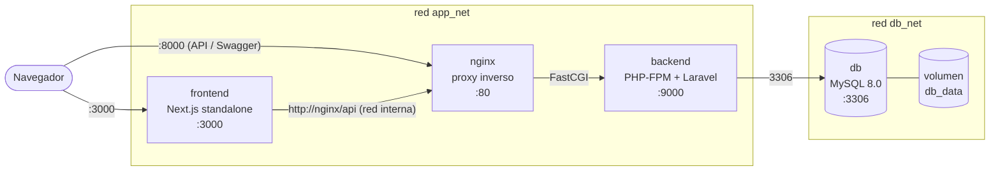

# Ecosistema E-commerce en Docker — Next.js + Laravel + MySQL

- App Next.js en GitHub
https://github.com/KenOO2/Kodigo_Tarea_WebAsincrona

- Api Laravel + BS MySQL en GitHub
https://github.com/KenOO2/Kodigo_Tarea_APIecommerce

Entorno de producción contenerizado para una tienda en línea de tres servicios, con
**builds multi-stage**, imágenes ligeras, usuarios sin privilegios y todo orquestado con
**un solo comando**.

| Servicio | Tecnología | Imagen base | Puerto (host) |
|---|---|---|---|
| `frontend` | Next.js 16 (App Router) | `node:20-alpine` | `3000` |
| `nginx` + `backend` | Laravel 12 · PHP-FPM + Nginx | `php:8.2-fpm-alpine` · `nginx:1.27-alpine` | `8000` |
| `db` | MySQL 8.0 | `mysql:8.0` | *ninguno* (solo red interna) |

---

## 1. Arquitectura



**Cómo fluye una petición:** el navegador pide una página a `frontend`. El servidor de Next
(no el navegador) consulta la API en `http://nginx/api`, Nginx la reenvía por FastCGI a
PHP-FPM, y Laravel consulta MySQL. Por eso el navegador nunca necesita llegar a la API
directamente (solo para Swagger o pruebas con `curl`).

**Aislamiento de red:** hay dos redes. `frontend` y `nginx` están en `app_net`; `db` solo en
`db_net`; solo `backend` toca ambas. El frontend **no puede** alcanzar la base de datos, y
MySQL no publica ningún puerto en el host.

### Estructura del repositorio

```
.
├── docker-compose.yml        # orquestación de los servicios
├── .env.example              # variables documentadas (copiar a .env)
├── frontend/                 # Next.js 16 + Dockerfile (3 etapas)
├── backend/                  # Laravel 12 + Dockerfile (vendor → backend | nginx)
│   └── docker/               # php.ini, config de PHP-FPM, nginx, entrypoint
├── db/init/01-init.sql       # script SQL opcional (montado en /docker-entrypoint-initdb.d)
└── benchmark/                # Dockerfiles "antes" + script para medir tamaños
```

---

## 2. Ejecución

**Requisitos:** Docker Engine 24+ con Compose v2 y BuildKit (incluidos en Docker Desktop).

```bash
# 1) Configuración
cp .env.example .env
#    Edita .env: contraseñas de MySQL y llaves de Stripe (modo test)

# 2) Levantar todo (construye las imágenes la primera vez)
docker compose up -d --build

# 3) Ver el arranque del backend (espera a MySQL, migra, siembra, genera Swagger)
docker compose logs -f backend
```

| URL | Qué es |
|---|---|
| http://localhost:3000 | Tienda (frontend) |
| http://localhost:8000/api/products | API REST |
| http://localhost:8000/api/documentation | Swagger UI |

**Usuarios de demostración** (creados por el seeder): `admin@example.com` / `Admin123!` y
`cliente@example.com` / `Cliente123!`. Tarjeta de prueba de Stripe: `4242 4242 4242 4242`.

### Claves persistentes (recomendado)

Si `APP_KEY` y `JWT_SECRET` quedan vacíos, el contenedor genera claves **temporales** para que
todo arranque igual, pero cambian en cada reinicio (cierra las sesiones). Para fijarlas:

```bash
docker run --rm php:8.2-cli-alpine php -r "echo 'base64:'.base64_encode(random_bytes(32)).PHP_EOL;"   # → APP_KEY
docker run --rm php:8.2-cli-alpine php -r "echo bin2hex(random_bytes(32)).PHP_EOL;"                   # → JWT_SECRET
```

### Comandos útiles

```bash
docker compose ps                                  # estado y salud
docker compose logs -f backend                     # logs de Laravel (salen por stderr)
docker compose exec backend php artisan migrate:fresh --seed
docker compose --profile tools up -d               # + phpMyAdmin en http://localhost:8081
docker compose down                                # apagar (conserva los datos)
docker compose down -v                             # apagar y BORRAR la base de datos
```

> **Cambiar `STRIPE_PUBLISHABLE_KEY` o `NEXT_PUBLIC_API_BASE_URL` requiere reconstruir el
> frontend** (`docker compose up -d --build frontend`): Next.js las incrusta en el JavaScript
> durante `next build`.

### Verificación rápida

```bash
curl -s http://localhost:8000/api/products | head -c 300      # la API responde con productos
curl -sI http://localhost:3000 | head -1                       # el frontend responde 200
docker compose exec backend php -m | grep -Ei "pdo_mysql|mbstring|openssl|tokenizer|xml|ctype|json"
docker compose port db 3306                                    # debe fallar: MySQL no está expuesto
docker compose exec frontend id                                # uid=1001(nextjs): no es root
```

---

## 3. Decisiones técnicas

### 3.1 Frontend — `frontend/Dockerfile` (3 etapas)

| Etapa | Qué hace | Por qué |
|---|---|---|
| `deps` | `npm ci` con solo `package*.json` | Es la capa más lenta. Al depender únicamente del lockfile, Docker la reutiliza (`CACHED`) mientras no cambien las dependencias, aunque cambie todo el código. `--mount=type=cache` conserva además el caché de npm entre builds. |
| `builder` | Copia el código y ejecuta `next build` | Aquí viven las devDependencies y el código fuente; **nada de esto llega a la imagen final**. |
| `runner` | Copia solo `.next/standalone`, `.next/static` y `public/` | Imagen mínima. |

- **`output: "standalone"`** (en `next.config.ts`): Next traza qué `node_modules` se usan
  realmente y los incluye en `.next/standalone`. Se ejecuta con `node server.js`, equivalente
  optimizado de `next start`. Medido en este proyecto: el contenido que va a la imagen final
  pesa **68 MB**, frente a **528 MB** de `node_modules` + 128 MB de `.next` del build.
- **`ARG NEXT_PUBLIC_*`**: esas variables se incrustan en el bundle durante el build, por eso
  son *build args* y no variables de runtime. Solo se usa la llave **publicable** de Stripe,
  que es pública por diseño; ningún secreto entra al frontend.
- **`API_INTERNAL_URL` (runtime)**: las llamadas a la API ocurren en el *servidor* de Next
  (Server Components / Server Actions). Dentro de Docker `localhost` es el propio contenedor,
  así que el servidor usa `http://nginx/api` por la red interna. Es el único cambio de código:
  una línea en `lib/api.ts`, con fallback a `NEXT_PUBLIC_API_BASE_URL` para `npm run dev`.
- **Usuario `nextjs` (uid 1001)** sin privilegios, y `HOSTNAME=0.0.0.0` para que el servidor
  escuche fuera del contenedor.
- **El build no necesita la API**: todas las rutas son dinámicas, así que `docker build` no
  depende de que el backend esté levantado.

### 3.2 Backend — `backend/Dockerfile` (una fuente, dos imágenes)

```
vendor (composer:2) ──► backend (php:8.2-fpm-alpine)      imagen que ejecuta Laravel
                  └───► nginx   (nginx:1.27-alpine)       proxy inverso + estáticos
```

- **Etapa `vendor`**: Composer instala dependencias (`--no-dev`) y genera el autoloader
  optimizado. Composer, git y unzip **no existen** en la imagen final. Igual que en el
  frontend, `composer.json`/`composer.lock` se copian antes que el código para aprovechar la
  caché de capas (más `--mount=type=cache` para el caché de Composer).
- **Imagen `backend`**: copia **únicamente `vendor/`** de la etapa anterior y después el
  código (que cambia más seguido, por eso va en una capa posterior).
- **Extensiones PHP**: la imagen oficial ya trae compiladas `mbstring`, `openssl`, `tokenizer`,
  `xml`, `ctype` y `json`; solo se instalan `pdo_mysql` y `opcache`. El Dockerfile **verifica**
  las siete requeridas con `extension_loaded()` y el build falla si falta alguna.
- **PHP-FPM + Nginx en contenedores separados** (un proceso por contenedor, sin supervisord).
  Nginx se construye como un *target* del mismo Dockerfile y lleva solo `public/`; no se monta
  el código fuente como volumen, así que las imágenes son autocontenidas y reproducibles.
- **`php:8.2`** (el recomendado y el mínimo de Laravel 12); se cambia con `--build-arg PHP_VERSION`.
  Se fijó `config.platform.php = 8.2.0` en `composer.json` para que Composer, que corre en
  una imagen con un PHP más nuevo, no resuelva paquetes incompatibles con el runtime.
- **Configuración de producción**: `opcache.validate_timestamps=0` (el código no cambia dentro
  de un contenedor), `expose_php=Off`, `display_errors=Off`, `APP_DEBUG=false`,
  `config:cache` al arrancar, logs a `stderr` (visibles con `docker compose logs`).
- **`clear_env = no`** en PHP-FPM: por defecto FPM no pasa las variables del contenedor a sus
  workers, y Laravel las necesita.
- **`entrypoint.sh`**: espera a MySQL con las credenciales reales, genera claves temporales si
  faltan, corre `migrate`, siembra datos (idempotente), genera Swagger y deja `storage/` con
  dueño `www-data`. Conserva el saneo de `\r` para `.env` con saltos de línea de Windows.
- **Usuarios**: el proceso maestro de FPM corre como root (necesario para el entrypoint),
  pero **los workers que atienden peticiones corren como `www-data`**; los de Nginx, como `nginx`.
- **`.dockerignore`**: excluye `.env*`, `vendor`, `.git`, `tests` y los caches; los secretos
  nunca quedan dentro de una imagen.

### 3.3 Base de datos — `mysql:8.0`

- Configuración por variables de entorno (`MYSQL_ROOT_PASSWORD`, `MYSQL_DATABASE`,
  `MYSQL_USER`, `MYSQL_PASSWORD`); Laravel se conecta con el usuario de aplicación, **no con root**.
- Volumen nombrado `db_data` → `/var/lib/mysql`: los datos sobreviven a `docker compose down`.
- **Sin `ports:`**: el 3306 solo existe dentro de `db_net`.
- **`healthcheck`** con `mysqladmin ping -h 127.0.0.1` (TCP). Con `localhost` usaría el
  socket, y durante la inicialización MySQL levanta un servidor temporal sin red que haría
  pasar el healthcheck demasiado pronto. `backend` espera con `condition: service_healthy`.
- **Esquema**: la API ya lleva su base de datos: **las tablas las crean las migraciones y los
  datos de demo los seeders de Laravel**. Por eso `db/init/01-init.sql` (montado en
  `/docker-entrypoint-initdb.d/`) es opcional y no define tablas: duplicarlas desincronizaría
  el esquema. Se ejecuta una sola vez, al crearse el volumen.

### 3.4 `docker-compose.yml`

- Al backend se le pasan **solo** las variables que necesita (lista explícita en `environment`),
  de modo que, por ejemplo, `MYSQL_ROOT_PASSWORD` no entra en ese contenedor.
- Las variables obligatorias usan `${VAR:?mensaje}`: sin `.env`, Compose falla con un mensaje
  claro en lugar de arrancar a medias.
- phpMyAdmin está en el *profile* `tools` (no arranca por defecto) y, cuando se activa, solo
  escucha en `127.0.0.1`.
- Todos los servicios tienen `restart: unless-stopped`.

---

## 4. Resultados: antes vs. después

La carpeta `benchmark/` conserva los Dockerfiles de una sola etapa ("antes") para medir de
forma reproducible:

```bash
bash benchmark/compare-sizes.sh
```

Pega aquí la salida del script (build sin caché):

| Imagen | Antes | Después |
|---|---|---|
| Frontend | _… MB_ | _… MB_ |
| Backend (PHP-FPM) | _… MB_ | _… MB_ |
| Nginx | — | _… MB_ |

**Caché de capas:** modifica un archivo de `frontend/app/` y ejecuta
`docker compose build frontend`: la etapa `deps` aparece como `CACHED` y el rebuild omite
`npm ci`. Lo mismo ocurre con `composer install` en el backend al tocar código PHP.

---

## 5. Problemas frecuentes

| Síntoma | Causa y solución |
|---|---|
| `Falta MYSQL_PASSWORD…` al ejecutar compose | No existe `.env`. Ejecuta `cp .env.example .env`. |
| El frontend muestra "No se pudo conectar con la API" | El backend aún está arrancando (migraciones). Revisa `docker compose logs backend`. |
| Stripe falla en el checkout | `STRIPE_PUBLISHABLE_KEY` y `STRIPE_SECRET` deben ser de la **misma** cuenta; tras cambiar la publicable, reconstruye el frontend. |
| 502 Bad Gateway en `:8000` | `backend` sigue iniciando o terminó con error: `docker compose ps` y `logs backend`. |
| Cambié contraseñas de MySQL y no surten efecto | MySQL solo las lee al crear el volumen: `docker compose down -v` y vuelve a levantar. |

---

## 6. Reproducibilidad: fijar `composer.lock`

El proyecto original no incluía `composer.lock`, así que cada build resuelve versiones
actuales dentro de los rangos de `composer.json`. Para builds idénticos entre entornos,
genera el lock **una vez** y súbelo al repositorio:

```bash
docker run --rm -v "$PWD/backend":/app -w /app composer:2 update --no-install --no-scripts
git add backend/composer.lock
```

(Si Composer se queja de extensiones de la plataforma, añade `--ignore-platform-reqs`.)
El Dockerfile ya lo usa automáticamente cuando existe.
